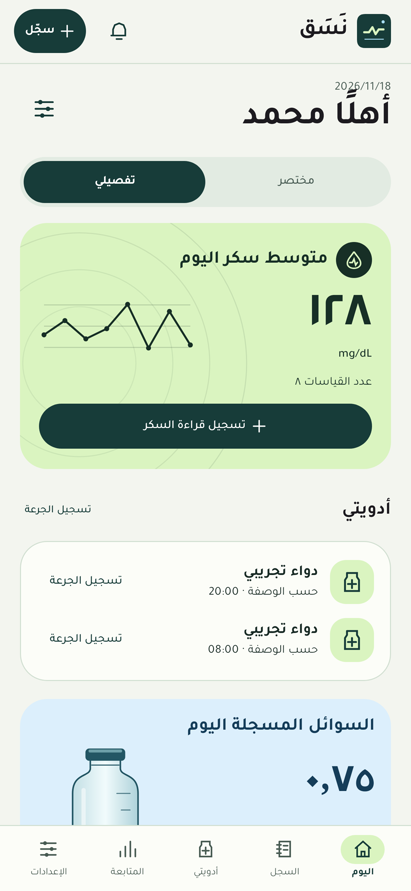
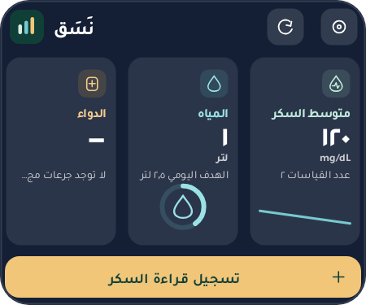

# نَسَق · Nasaq

تطبيق أندرويد عربي وإنجليزي لتسجيل قراءات السكر والمياه والأدوية ومراجعة اليوم. اسمه في الإصدارات السابقة «يومي». مشروع مفتوح المصدر من تطوير [محمد عبدالنبي](https://fb.com/mohamedabdelnaby190).

[صفحة العرض](https://mohamedabdelnaby1.github.io/nasaq-android/) · [إصدار أندرويد 0.6.0](https://github.com/Mohamedabdelnaby1/nasaq-android/releases/tag/v0.6.0)

 

## الاستخدام

- **اليوم** يعرض متوسط قياسات السكر لليوم، مجموع المياه، والجرعات المسجّلة. المتوسط الحسابي يجمع قراءات اليوم بعد تحويلها إلى وحدة مشتركة، ثم يعرض الناتج بالوحدة المختارة.
- **المياه** تعرض الزجاجة ومستوى الامتلاء والكوبايات القابلة للتسجيل. متوسط المياه اليومي يستخدم الأيام التي فيها تسجيل من آخر سبعة أيام مكتملة.
- **الويدجت** يدعم عرضًا مجمّعًا وويدجت منفصلًا للسكر أو المياه أو الدواء أو ملخص اليوم. كل بطاقة تفتح قسمها، والأزرار السريعة لها إجراءات مستقلة. عرض القيم على الشاشة الرئيسية اختياري.
- **السجل والمتابعة** يدعمان سجل الأكل والأعراض والنوم والجرعات، التذكيرات، تصدير CSV، وطباعة تقرير PDF.
- **الخصوصية** السجل محفوظ مشفّرًا على الجهاز. يمكن تصدير نسخة احتياطية مشفّرة بكلمة مرور واسترجاعها على جهاز آخر. يدعم التطبيق قفل الجهاز وتقليل الحركة.

## البناء والاختبار

يتطلب JDK 17 أو أحدث وAndroid SDK 36 مع Build Tools 36.0.0. أقدم نظام مدعوم هو Android 8.0. على Windows استخدم المسار المختصر أدناه مع اسم مجلد بحروف لاتينية إذا رفض Android Gradle Plugin مسارًا عربيًا.

```sh
./gradlew :app:assembleDebug :app:testDebugUnitTest :app:lintDebug
```

على Windows استخدم `gradlew.bat` مكان `./gradlew`. ستجد APK في `app/build/outputs/apk/debug/app-debug.apk`. مسار GitHub Actions يبني APK تطوير وينشره ضمن نتائج كل تشغيل ناجح. يتطلب تحديث تطبيق مثبّت توقيعًا مطابقًا للإصدار الموجود على الجهاز.

## موقع المشروع

الموقع الثابت في [site](site/). يضم لقطات ببيانات تجريبية ومعاينة تفاعلية لامتلاء الزجاجة. يجهّز سير العمل **Publish project website** ملفات الموقع لـGitHub Pages عند اختيار GitHub Actions كمصدر نشر المستودع.

## الترخيص

الكود تحت [رخصة MIT](LICENSE). خط تجوال مرفق وفق [SIL Open Font License](app/src/main/assets/licenses/Tajawal-OFL.txt). حقوق المطور © 2026 محمد عبدالنبي.
