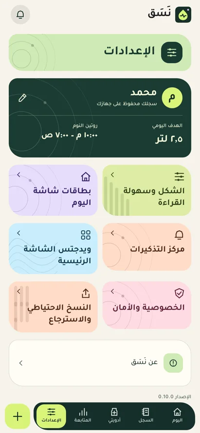
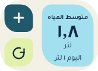

<p align="center"></p>

<h1 align="center">نَسَق</h1>

<p align="center">سجّل السكر والمياه والوجبات والجرعات، وارجع ليومك من مكان واحد.</p>

<p align="center">
  <a href="https://github.com/Mohamedabdelnaby1/nasaq-android/releases/download/v0.10.0/Nasaq-v0.10.0.apk"></a>
  <a href="https://github.com/Mohamedabdelnaby1/nasaq-android/releases"></a>
  <a href="LICENSE"></a>
</p>

<p align="center"><a href="#download">التنزيل</a> · <a href="#screens">الشاشات والحركة</a> · <a href="#features">المميزات</a> · <a href="#build">البناء</a></p>

<a id="download"></a>
## التنزيل

**أندرويد 8.0 فأحدث** · العربية والإنجليزية · البيانات محفوظة على الجهاز.

1. [نزّل Nasaq-v0.10.0.apk مباشرة](https://github.com/Mohamedabdelnaby1/nasaq-android/releases/download/v0.10.0/Nasaq-v0.10.0.apk) من GitHub.
2. ثبّت الملف أو افتحه كتحديث لو النسخة الحالية من إصدارات المشروع بنفس التوقيع.
3. [أحدث إصدار](https://github.com/Mohamedabdelnaby1/nasaq-android/releases/latest) فيه بصمة **SHA-256** للملف وكود الإصدار. الإصدارات القديمة متاحة في [الأرشيف](https://github.com/Mohamedabdelnaby1/nasaq-android/releases).

### الجديد في 0.10.0

- هوية جديدة لنَسَق. بنفسجي للسكر، وأزرق للمياه، وخوخي للأدوية، وذهبي للوجبات.
- شريط تنقّل جديد، وزر تسجيل سريع، وتصميم جديد للسجل والأدوية والمتابعة والإعدادات.
- الزجاجة والكوبايات بتتفاعل مع تسجيل المياه. حركة الانتقال بتربط بطاقة اليوم بتفاصيلها.
- الويدجتس بتعرض المتوسط، وفي الاستوديو تقدر تشوف معاينة متحركة للقالب والمقاس قبل الإضافة.

<a id="screens"></a>
## الشاشات والحركة

اللقطات التالية من نسخة أندرويد وبتستخدم بيانات تجريبية.

| يومك | المياه | الإعدادات |
| :---: | :---: | :---: |
|  |  |  |

| الويدجتس | تسجيل المياه |
| :---: | :---: |
|  |  |

[الخط الزمني](docs/media/timeline.webp) · [معاينة التنقل بين الشاشات](docs/media/navigation.webp) · [معاينة حركة امتلاء الكوبايات](docs/media/water-motion.webp)

<a id="features"></a>
## المميزات

| الجزء | اللي تقدر تعمله |
| --- | --- |
| **اليوم** | تبدّل بين المختصر والتفصيلي، ترتّب البطاقات بالسحب وتشوف معاينتها، وتفتح يوم من شريط التقويم. |
| **الخط الزمني والمتابعة** | تشوف السكر والأكل والمياه والجرعات حسب الساعة، وتقارن متوسط القراءات وعددها لفترات ٧ أو ١٤ أو ٢٨ يوم، مع تصفية قبل الأكل وبعده. |
| **تسجيل سريع** | تكتب «شربت ٢٥٠ مل» وتراجع المسودة قبل الحفظ. التطبيق يرتّب الاختصارات حسب استخدامك ويعرض الكمية المتكررة من سجلّك. تقدر تثبّت اختصار، تخفي كمية مقترحة، أو تبدأ التعلّم المحلي من جديد من الإعدادات. |
| **الويدجتس** | تختار القالب والمقاس والألوان والمحتوى، وتشوف معاينة قبل الإضافة. كل بطاقة تفتح القسم بتاعها، وفي مقاس مياه صغير بيفتح شاشة المياه من البطاقة نفسها، وفيه إجراءات منفصلة للتسجيل والتراجع. |
| **أدوات السجل** | تستورد CSV بمعاينة للتكرار والصفوف غير الصالحة، وتحدد أقسام تقرير PDF واسمه وتكتب ملاحظتك قبل تصديره. تقدر تنقل السجل بنسخة مشفّرة وتراجع الدمج قبل الحفظ. |
| **الوقت** | المواعيد ومحرر الوقت يظهروا بنظام ١٢ ساعة. CSV بيستخدم توقيت ISO لنقل البيانات بين الأدوات. |

### استيراد CSV

تقدر تبدأ بملف صادر من نَسَق. لو بتجهّز ملف بنفسك، الأعمدة المطلوبة هي `measured_at_iso` و`kind` و`value` أو `value_original`. السكر والمياه ليهم عمود وحدة `unit`.

```csv
measured_at_iso,kind,value,unit
2026-11-17T07:30:00Z,water,250,mL
2026-11-17T08:00:00Z,glucose,118,mg/dL
```

### الخصوصية

السجل مشفّر على الجهاز، وتقدر تعمل نسخة احتياطية مشفّرة بكلمة مرور. إظهار القراءات على الشاشة الرئيسية اختيار مستقل لكل ويدجت. ترتيب الاختصارات بيتحسب على الجهاز من السجل.

<a id="build"></a>
## البناء والمساهمة

يتطلب **JDK 17** و**Android SDK 36** مع **Build Tools 36.0.0**. مسار الاختبار الرسمي في [GitHub Actions](https://github.com/Mohamedabdelnaby1/nasaq-android/actions).

```sh
./gradlew :app:assembleDebug :app:testDebugUnitTest :app:lintDebug
```

على Windows استخدم `gradlew.bat`. ملف البناء بيظهر في `app/build/outputs/apk/debug/`. للإبلاغ عن مشكلة أو اقتراح ميزة استخدم [Issues](https://github.com/Mohamedabdelnaby1/nasaq-android/issues).

## الترخيص

تطوير [محمد عبدالنبي](https://fb.com/mohamedabdelnaby190) · [رخصة MIT](LICENSE) · [ترخيص خط تجوال](app/src/main/assets/licenses/Tajawal-OFL.txt).
