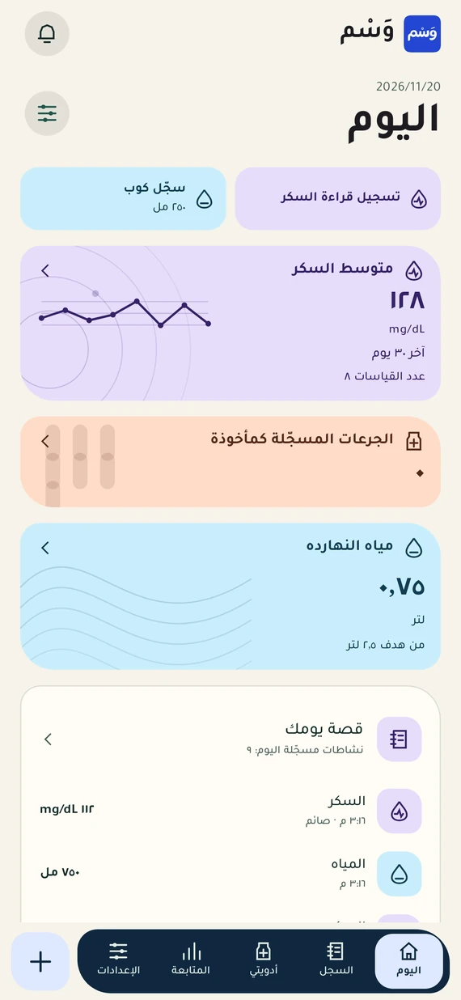
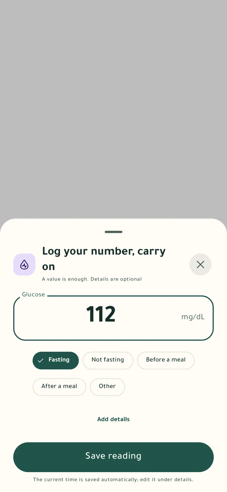
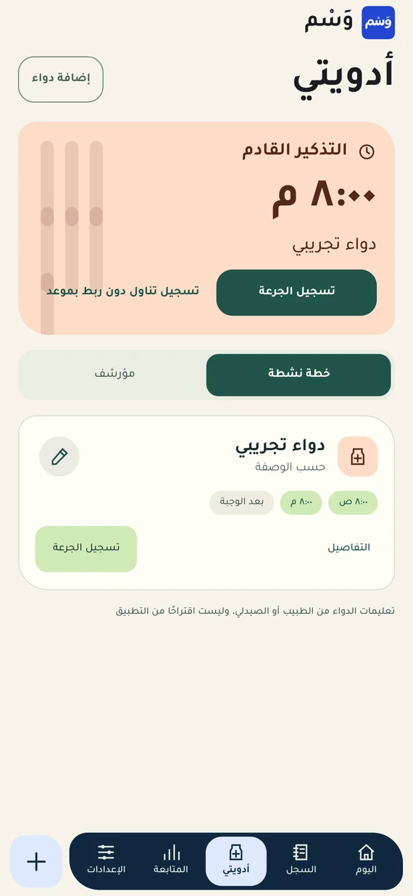
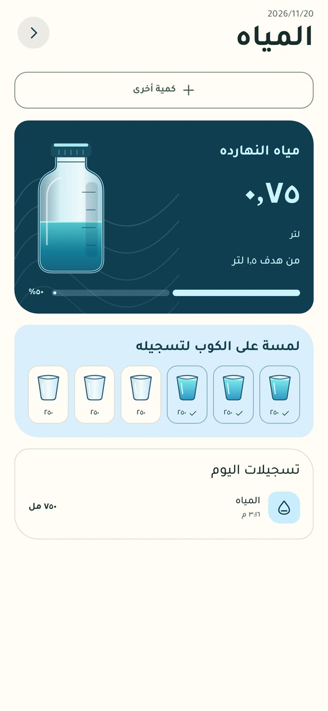
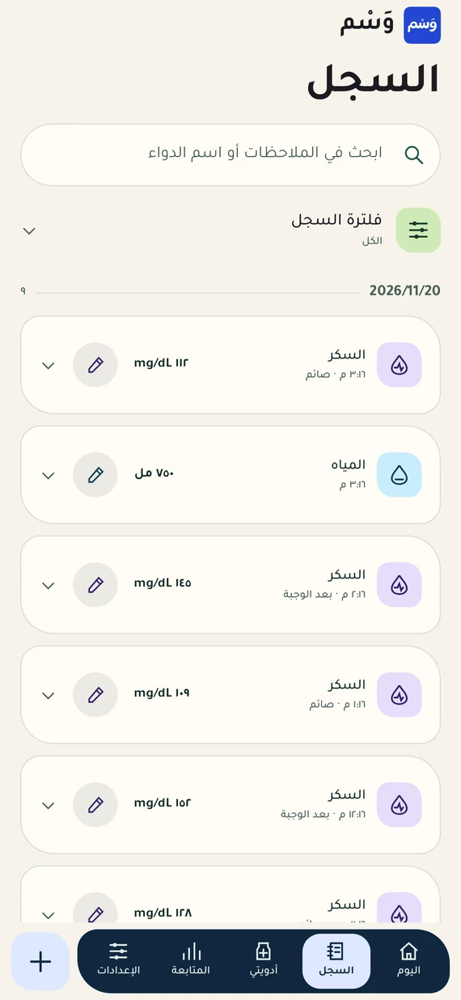
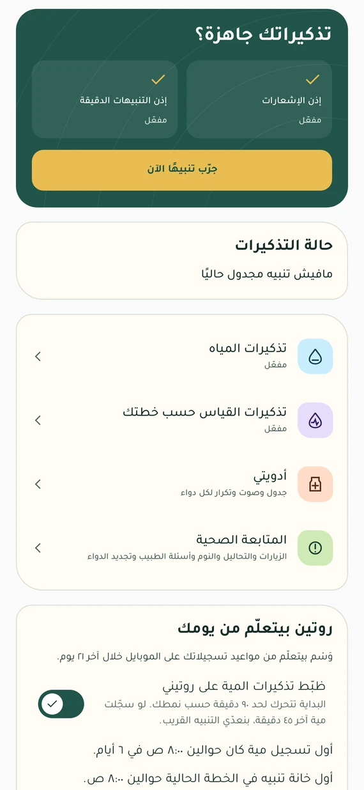
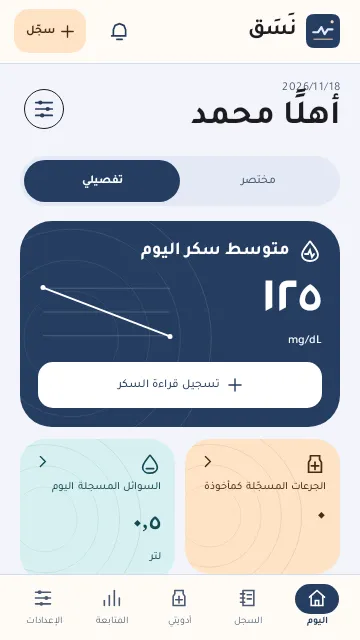
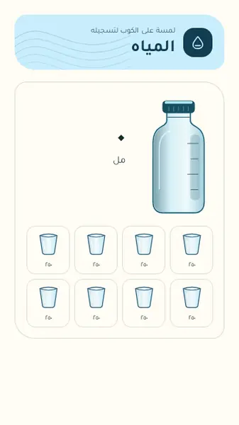
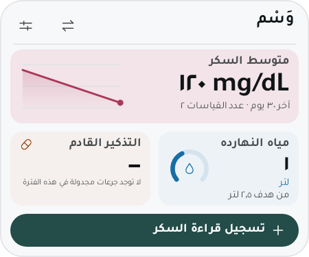

<p align="center"></p>

<p align="center"><strong>سجّل قراءات السكر، تابع دواك، واعرف شربت مية قد إيه.</strong></p>
<p align="center">متابعة يومية للسكري على أندرويد، مع تذكيرات بتتكيّف مع روتينك. التطبيق مجاني ومفتوح المصدر.</p>

<p align="center">
  <a href="https://github.com/Mohamedabdelnaby1/nasaq-android/releases/download/v0.18.0/Wasm-v0.18.0.apk"></a>
  <a href="https://github.com/Mohamedabdelnaby1/nasaq-android/releases/latest"></a>
  <a href="#screens"></a>
</p>

<p align="center">أندرويد 8.0 أو أحدث · عربي وإنجليزي · وضع فاتح وداكن</p>
<p align="center"><a href="#features">المميزات</a> · <a href="#install">التثبيت</a> · <a href="#build">بناء المشروع</a></p>

<a id="screens"></a>
## شوف وَسْم

<sub>لقطات من الإصدار 0.18.0 بأرقام تجريبية. اضغط على أي لقطة عشان تفتحها بالحجم الكامل.</sub>

<p align="center">
  <a href="docs/media/today.webp"></a>
  <a href="docs/media/glucose-entry.webp"></a>
  <a href="docs/media/medicines.webp"></a>
</p>
<p align="center"><strong>اليوم · تسجيل السكر · أدويتي</strong></p>

<p align="center">
  <a href="docs/media/hydration.webp"></a>
  <a href="docs/media/journal.webp"></a>
  <a href="docs/media/routine-learning.webp"></a>
</p>
<p align="center"><strong>المية · السجل · التذكيرات المتكيّفة</strong></p>

### التطبيق وهو شغّال

| التنقّل بين الشاشات | حركة تسجيل المية |
| :---: | :---: |
| <a href="docs/media/navigation.webp"></a> | <a href="docs/media/water-motion.webp"></a> |

### الويدجتس والتقارير

| ويدجت اليوم | ويدجت المية |
| :---: | :---: |
| <a href="docs/media/widget-board.png"></a> | <a href="docs/media/widget-water.png"></a> |

[معاينة استوديو الويدجتس](docs/media/widget-studio.webp) · [معاينة تقرير PDF](docs/media/report.webp)

<a id="features"></a>
## المميزات

| الميزة | بتعمل إيه؟ |
| --- | --- |
| **السكر** | تسجّل القراءات وسياقها وتشوف المتوسط لفترة تختارها، مع دعم `mg/dL` و`mmol/L`. |
| **الأدوية** | تضيف مواعيد الدوا، تشوف التذكير الجاي، وتسجّل حالة كل جرعة. |
| **المية** | تشوف إجمالي اللي شربته النهارده وتسجّل كوباية بسرعة، وتضبط هدفك وحجم الكوباية. |
| **التذكيرات المتكيّفة** | بتتعلم من مواعيد تسجيلك على الجهاز وتضبط توقيت تذكيرات المتابعة اللي تسمح بيها. تقدر تقفل التكيّف أو تمسح الروتين المتعلَّم من الإعدادات. |
| **ويدجتس الشاشة الرئيسية** | تعرض السكر أو المية أو الدوا حسب القالب والمحتوى اللي اخترته، مع اختصارات للتسجيل. |
| **السجل والتصدير** | تراجع يومك، وتصدّر CSV أو تقرير PDF وتحتفظ بنسخة احتياطية محلية. |

بيانات السجل وتعلّم الروتين على جهازك. تقدر تشارك ملف التصدير وقت ما تحتاجه.

<a id="install"></a>
## التثبيت والتحديث

1. حمّل [Wasm-v0.18.0.apk](https://github.com/Mohamedabdelnaby1/nasaq-android/releases/download/v0.18.0/Wasm-v0.18.0.apk) وافتحه على الموبايل.
2. اسمح بالتثبيت من تطبيق التحميل لو أندرويد طلب الإذن.
3. لو عندك إصدار رسمي من 0.16.0 أو أحدث، ثبّت التحديث فوقه للاحتفاظ ببياناتك.

[كل الإصدارات](https://github.com/Mohamedabdelnaby1/nasaq-android/releases) · [ملف التحقق SHA-256](https://github.com/Mohamedabdelnaby1/nasaq-android/releases/download/v0.18.0/Wasm-v0.18.0-SHA256.txt)

<details>
<summary>استيراد قراءات بصيغة CSV</summary>

افتح الاستيراد من الإعدادات. استخدم `measured_at_iso` و`kind` و`value` أو `value_original`. حدّد وحدة القياس في `unit`.

```csv
measured_at_iso,kind,value,unit
2026-11-17T07:30:00Z,water,250,mL
2026-11-17T08:00:00Z,glucose,118,mg/dL
```

</details>

<a id="build"></a>
## بناء المشروع والمساهمة

المتطلبات **JDK 17** و**Android SDK 36** مع **Build Tools 36.0.0**.

```sh
./gradlew :app:assembleDebug :app:testDebugUnitTest :app:lintDebug
```

على ويندوز استخدم `gradlew.bat`. هتلاقي APK التجريبي في `app/build/outputs/apk/debug/`.

[فحوصات البناء](https://github.com/Mohamedabdelnaby1/nasaq-android/actions) · [دليل تجربة النسخة](docs/BETA_QA_AR.md) · [بلّغ عن مشكلة أو اقترح فكرة](https://github.com/Mohamedabdelnaby1/nasaq-android/issues)

[محمد عبدالنبي](https://fb.com/mohamedabdelnaby190) · [رخصة MIT](LICENSE) · [ترخيص خط تجوّل](app/src/main/assets/licenses/Tajawal-OFL.txt)
